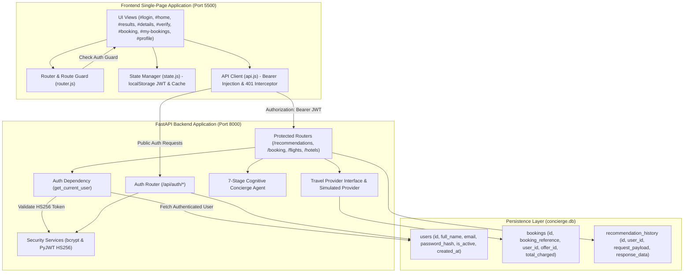
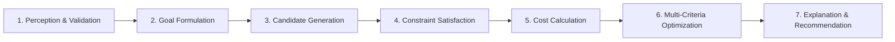
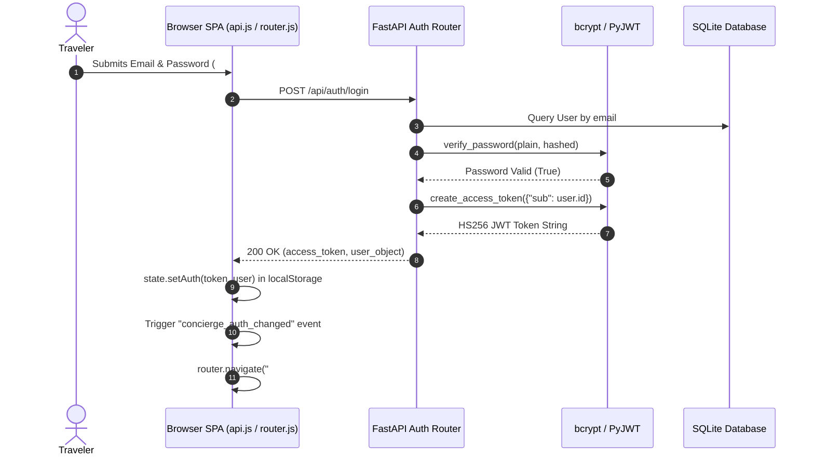
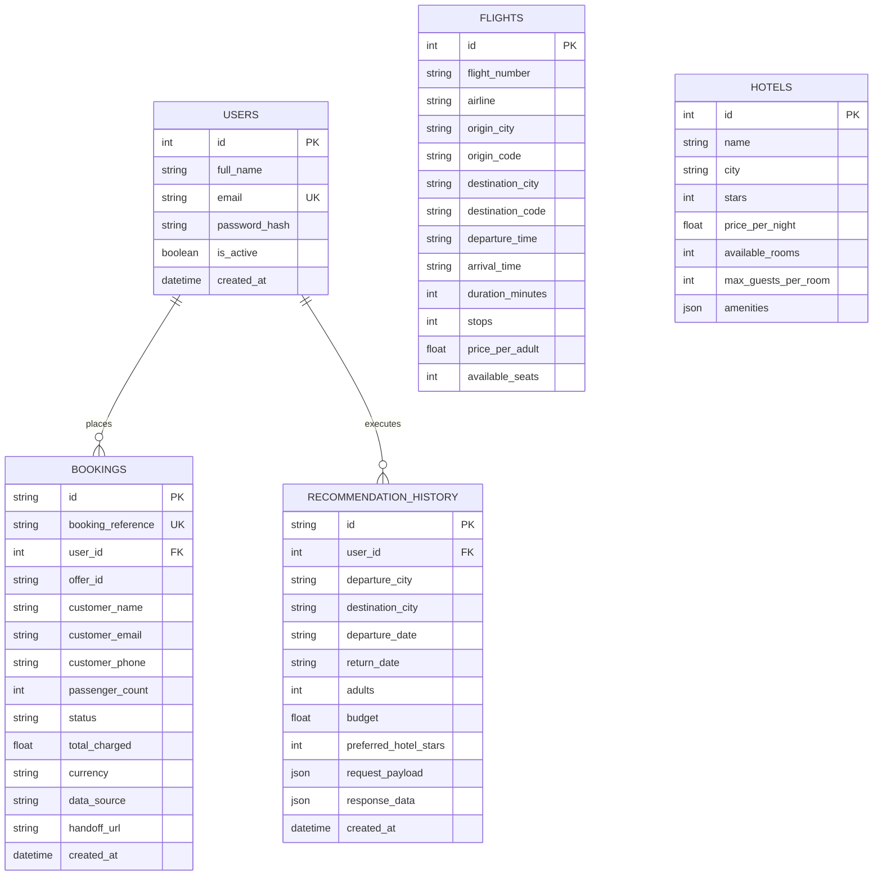

# Automated E-Commerce Concierge Agent
## AI-Powered Intelligent Travel Planning and Recommendation System

[](https://fastapi.tiangolo.com)
[](https://www.python.org/)
[](https://www.sqlalchemy.org/)
[](https://pyjwt.readthedocs.io/)
[](frontend/)
[-brightgreen.svg)](backend/tests/)
[](test_e2e_chrome.js)

An intelligent full-stack AI travel concierge application that synthesizes user preferences, queries flight and hotel inventories, enforces domain constraints, optimizes costs, and delivers explainable travel package recommendations with complete JWT authentication, multi-tenant isolation, and a simulated reservation lifecycle.

---

## Table of Contents

- [1. Project Overview](#1-project-overview)
- [2. Problem Statement](#2-problem-statement)
- [3. Project Objectives](#3-project-objectives)
- [4. Key Features](#4-key-features)
- [5. Technology Stack](#5-technology-stack)
- [6. System Architecture](#6-system-architecture)
- [7. AI Agent Working Mechanism](#7-ai-agent-working-mechanism)
- [8. AI Decision-Making and Optimization](#8-ai-decision-making-and-optimization)
- [9. Backend Architecture](#9-backend-architecture)
- [10. Frontend Architecture](#10-frontend-architecture)
- [11. JWT Authentication Architecture](#11-jwt-authentication-architecture)
- [12. Multi-Tenant Data Isolation](#12-multi-tenant-data-isolation)
- [13. Complete Application Workflow](#13-complete-application-workflow)
- [14. API Documentation](#14-api-documentation)
- [15. Database Design](#15-database-design)
- [16. Project Folder Structure](#16-project-folder-structure)
- [17. Installation Requirements](#17-installation-requirements)
- [18. How to Run the Project](#18-how-to-run-the-project)
- [19. Testing and Verification](#19-testing-and-verification)
- [20. Current Limitations and Future Enhancements](#20-current-limitations-and-future-enhancements)
- [21. Authors and Contributors](#21-authors-and-contributors)

---

## 1. Project Overview

The **Automated E-Commerce Concierge Agent** is a full-stack, goal-driven travel recommendation platform designed to automate the complex process of planning multi-city vacations and business trips. Rather than acting as a simple catalog viewer displaying static, pre-packaged holiday deals, the application employs a **Goal-Based Intelligent Agent** architecture rooted in classic Artificial Intelligence principles (Russell & Norvig, *Artificial Intelligence: A Modern Approach*).

The agent perceives structured user preferences (departure and destination cities, calendar dates, party size, total financial budget, hotel star preferences, and flight stop constraints), formulates an explicit optimization goal, retrieves live or simulated inventory across flights and hotels, filters infeasible candidate pairings using rigorous constraint satisfaction, calculates precise itemized expenses, and executes deterministic multi-criteria optimization to rank the best feasible travel package alongside viable alternatives.

The application includes an end-to-end user experience: secure JWT registration and login, client-side route guards, interactive travel configuration, instant results with transparent cost breakdowns, deep package inspection, dynamic inventory offer re-verification, simulated booking with duplicate submission protection, personal booking history, search replay, and traveler profile metrics.

---

## 2. Problem Statement

Conventional online travel booking platforms suffer from significant cognitive friction and operational inefficiencies:

1. **Information Overload & Manual Assembly**: Travelers are forced to open dozens of browser tabs to independently compare outbound flights, return flights, and hotels, manually keeping track of dates, arrival times, and checkout policies.
2. **Combinatorial Complexity**: In an airline and hotel network, pairing $N$ outbound flights, $M$ return flights, and $H$ lodging options yields $N \times M \times H$ possible combinations, making manual evaluation virtually impossible for human planners.
3. **Budget Ceilings vs. Hidden Costs**: Finding travel options that fit strictly within an overall budget is frustrating when platforms fail to account for per-passenger flight fares, per-room nightly lodging rates, occupancy limits, and taxes simultaneously.
4. **Opaque Trade-Offs**: Traditional booking engines rarely explain *why* a specific itinerary was selected, hiding whether an option was chosen because it was the cheapest, had fewer layovers, or offered better departure timing.
5. **Lack of Dynamic Re-Verification**: Real-time travel inventory prices and seat availabilities fluctuate constantly. Booking an itinerary based on stale search results leads to cart failures, sudden repricing, or expired inventory errors at checkout.

This project directly resolves these issues by embedding an automated AI concierge agent that handles candidate generation, constraint elimination, mathematical optimization, and offer re-validation automatically.

---

## 3. Project Objectives

1. **Goal-Based Agent Decision Framework**: Formulate the travel recommendation problem as an explicit constraint optimization problem: $\min \text{Total Cost}$ subject to strict route continuity, date consistency, seat capacity, room occupancy, and budget limits.
2. **Hard Constraint Satisfaction vs. Soft Preference Optimization**: Guarantee that zero invalid combinations are ever presented to the user, while flexibly incorporating secondary traveler preferences (e.g., preferred airline, direct flights, higher hotel ratings) during ranking.
3. **Deterministic Multi-Criteria Tie-Breaking**: Eliminate nondeterminism so that identical user requests consistently yield predictable, reproducible, and verifiable recommendations.
4. **Transparent Explainability**: Deliver detailed itemized cost breakdowns and diagnostic explanations that clarify exactly how money was allocated or why an infeasible search failed.
5. **Safe Two-Phase Booking Lifecycle**: Prevent accidental or out-of-sync reservations through pre-booking offer verification (`/api/verify-offer`) and mandatory explicit traveler confirmation (`confirm: true`).
6. **Multi-Tenant Security & Isolation**: Ensure complete user privacy through industry-standard bcrypt password hashing, cryptographically signed JSON Web Tokens (JWT), and database query isolation.
7. **Clean Vanilla Frontend Architecture**: Provide a responsive single-page application using pure HTML5, CSS3, and modern vanilla ES6 JavaScript—completely eliminating heavy node-based frontend frameworks, virtual DOM layers, and complex build tooling.

---

## 4. Key Features

- **User Authentication**: Secure user registration, credential validation, login, profile retrieval, and logout endpoints.
- **Cryptographic Security**: Passwords hashed using `bcrypt` with automatic salt generation; stateless session authentication powered by `PyJWT` signed with `HS256`.
- **Client Route Guards**: Protected single-page views automatically bounce unauthenticated visitors to `#login`, while redirecting logged-in users away from auth forms to `#home`.
- **Multi-Tenant Data Isolation**: All searches and bookings are bound to the authenticated `user_id`. Direct URL lookups or history queries for records owned by other users return `404 Not Found`.
- **7-Stage Cognitive Agent**: Perception, Goal Formulation, Candidate Generation, Constraint Satisfaction, Cost Calculation, Optimization, and Explanation.
- **Itemized Financial Transparency**: Mathematical cost breakdown across outbound flights, return flights, and hotel rooms with exact per-passenger and per-night totals in Indian Rupees (₹).
- **Intelligent Infeasible Query Diagnostics**: When budget or inventory constraints cannot be met, the agent details why combinations were rejected and provides tailored suggestions (e.g., minimum budget required, flexible hotel tiers).
- **Two-Phase Inventory Verification**: Dynamic pre-booking check that simulates airline/hotel provider inventory status (`VERIFIED`, `OFFER_REPRICED`, `OFFER_EXPIRED`).
- **Simulated Booking Engine**: Generates unique reservation codes (`SIM-RES-XXXXXXXX`) with duplicate booking prevention per offer and user.
- **Booking & Search Replay**: Dedicated `#my-bookings` view and `#history` tab allowing instant retrieval and one-click reloading of past travel queries.
- **Traveler Profile Dashboard**: Real-time summary showing user information, total bookings completed, and total search runs executed.
- **100% Framework-Free Frontend**: Crafted with clean semantic HTML, modular CSS with CSS Custom Properties, and ES6 JavaScript classes.

---

## 5. Technology Stack

### Backend & AI Engine
| Layer | Technology | Purpose |
| :--- | :--- | :--- |
| **Framework** | FastAPI (0.115+) | High-performance asynchronous Python REST API framework |
| **Server Engine** | Uvicorn (0.30+) | ASGI web server for lightning-fast request handling |
| **Data Validation** | Pydantic v2 (2.8+) | Strict request/response payload schema enforcement |
| **ORM** | SQLAlchemy (2.0+) | Object-Relational Mapping and database abstraction |
| **Database** | SQLite (Production: PostgreSQL) | ACID-compliant relational persistence |
| **AI Paradigm** | Classical Goal-Based Agent | Constraint satisfaction and multi-criteria optimization |

### Authentication & Security
| Component | Technology | Specification |
| :--- | :--- | :--- |
| **Password Hashing** | `bcrypt` (4.0+) | 12-round salted password hashing |
| **Token Standard** | `PyJWT` (2.8+) | RFC 7519 JSON Web Tokens (JWT) |
| **Signature Algorithm** | HMAC-SHA256 (`HS256`) | Cryptographic signature with 24-hour expiration |
| **Dependency Injection** | FastAPI `Depends` | Automated token verification and user extraction |

### Frontend
| Component | Technology | Specification |
| :--- | :--- | :--- |
| **Markup** | HTML5 | Semantic, accessible document structure |
| **Styling** | Modern CSS3 | Custom Properties (variables), Flexbox, CSS Grid, Responsive Design |
| **Scripting** | Vanilla ES6 JavaScript | Native modules (`import`/`export`), `async`/`await`, Fetch API |
| **Routing** | Hash-Based Router | Zero-dependency client-side routing (`#login`, `#home`, etc.) |
| **State** | `localStorage` Manager | Reactive persistence for JWT tokens, session user, and search state |

### Testing & Verification
| Suite | Technology | Target |
| :--- | :--- | :--- |
| **Backend Unit & Integration** | Pytest (8.3+) + HTTPX | 73 automated tests covering agent logic, API contracts, auth, and isolation |
| **Browser End-to-End** | Node.js + Chrome CDP | Real Google Chrome DevTools Protocol automation across all 10 user steps |

---

## 6. System Architecture

The application is structured as a decoupled multi-tier architecture where the vanilla JavaScript frontend interacts with the FastAPI backend exclusively via JSON REST endpoints over HTTP.



---

## 7. AI Agent Working Mechanism

The core recommendation engine is an implementation of a **Goal-Based Intelligent Agent** (Russell & Norvig, Chapter 2). Unlike simple recommendation filters or machine learning classifiers that predict historical preferences, this agent operates through a deterministic 7-stage cognitive pipeline:



### Stage 1: Perception & Validation
- **Input**: The agent perceives raw environment stimuli via the user's travel request payload:
  - Origin City (`departure_city`) and Destination City (`destination_city`)
  - Departure Date (`departure_date`) and Return Date (`return_date`)
  - Number of Adult Passengers (`adults`)
  - Financial Budget (`budget`) in INR
  - Preferred Hotel Category (`preferred_hotel_stars`) and strictness flag (`hotel_category_is_hard`)
  - Preferred Airline (`preferred_airline`)
  - Flight Stops Policy (`max_flight_stops`) and strictness flag (`max_flight_stops_is_hard`)
  - Hotel Amenities (`preferred_amenities`) and strictness flag (`amenities_are_hard`)
  - Room Sharing Policy (`room_sharing`: 1 or 2 adults per room)
- **Validation Rules**:
  - Temporal consistency: $\text{departure\_date} \le \text{return\_date}$ and $\text{departure\_date} \ge \text{today}$.
  - Route validity: $\text{departure\_city} \neq \text{destination\_city}$.
  - Positive domain values: $\text{adults} \ge 1$, $\text{budget} > 0$.

### Stage 2: Goal Formulation
The agent formulates an explicit operational goal state:
$$\text{Goal} = \arg\min_{p \in \mathcal{P}_{\text{feasible}}} \text{TotalCost}(p)$$
subject to maximizing secondary traveler satisfaction criteria whenever total package costs are equivalent.

### Stage 3: Candidate Generation
The agent interfaces with the inventory provider layer to retrieve:
- Outbound flights matching $\text{origin} \to \text{destination}$ on `departure_date`.
- Return flights matching $\text{destination} \to \text{origin}$ on `return_date`.
- Hotels situated in `destination` available for the duration of the trip ($\text{nights} = \text{return\_date} - \text{departure\_date}$).
- All combinatorial candidates are synthesized:
$$\mathcal{P}_{\text{candidates}} = \mathcal{F}_{\text{outbound}} \times \mathcal{F}_{\text{return}} \times \mathcal{H}_{\text{destination}}$$

### Stage 4: Constraint Satisfaction (CSP)
Each candidate package $p = (f_{\text{out}}, f_{\text{ret}}, h)$ is evaluated against mandatory **Hard Constraints**:
1. **Seat Capacity**: $\text{available\_seats}(f_{\text{out}}) \ge \text{adults}$ AND $\text{available\_seats}(f_{\text{ret}}) \ge \text{adults}$.
2. **Room Occupancy & Capacity**: Required rooms $R = \lceil \text{adults} / \text{capacity\_per\_room} \rceil$. Must satisfy $R \le \text{available\_rooms}(h)$.
3. **Mandatory Hotel Category**: If `hotel_category_is_hard == True`, $\text{stars}(h) \ge \text{preferred\_hotel\_stars}$.
4. **Mandatory Flight Stops**: If `max_flight_stops_is_hard == True`, $\text{stops}(f_{\text{out}}) \le \text{max\_flight\_stops}$ AND $\text{stops}(f_{\text{ret}}) \le \text{max\_flight\_stops}$.
5. **Mandatory Amenities**: If `amenities_are_hard == True`, $\text{preferred\_amenities} \subseteq \text{amenities}(h)$.
6. **Financial Feasibility**: $\text{TotalCost}(p) \le \text{budget}$.

Candidates violating any active hard constraint are immediately culled.

### Stage 5: Cost Calculation
Total cost is deterministically computed using standard travel pricing mathematics:
$$\text{FlightCost} = (\text{price}(f_{\text{out}}) + \text{price}(f_{\text{ret}})) \times \text{adults}$$
$$\text{HotelCost} = \text{price\_per\_night}(h) \times \text{nights} \times R$$
$$\text{TotalCost} = \text{FlightCost} + \text{HotelCost}$$
$$\text{Savings} = \text{budget} - \text{TotalCost}$$

### Stage 6: Multi-Criteria Optimization & Deterministic Ranking
All feasible candidates in $\mathcal{P}_{\text{feasible}}$ are sorted using a multi-criteria lexicographical key:
1. **Primary Key**: Lowest $\text{TotalCost}$.
2. **Tie-Breaker 1**: Fewest total flight stops $(\text{stops}(f_{\text{out}}) + \text{stops}(f_{\text{ret}}))$.
3. **Tie-Breaker 2**: Shortest combined flight duration $(\text{duration}(f_{\text{out}}) + \text{duration}(f_{\text{ret}}))$.
4. **Tie-Breaker 3**: Departure time convenience (penalizing red-eye flights between 23:00 and 05:00).
5. **Tie-Breaker 4**: Highest hotel star rating.
6. **Tie-Breaker 5**: Deterministic package ID comparison to guarantee 100% reproducible ordering.

### Stage 7: Explanation & Recommendation
- **Best Package**: The candidate ranked at position 0 is designated as `best_package`.
- **Alternative Packages**: The next distinct options (up to 3) are provided as `alternative_packages` to give travelers diverse options.
- **Natural Language Explanation**: A human-readable synthesis explaining why the package was selected, how much budget was saved, and the key highlights.
- **Infeasible Diagnostics**: If $\mathcal{P}_{\text{feasible}} = \emptyset$, the agent does not crash. Instead, it aggregates rejection tallies and generates actionable diagnostic advice (e.g., *"Cheapest package found was ₹54,000. Increase budget by ₹4,000 or allow 3-star hotels"*).

> **AI Paradigm Clarification**: This system is a formal **Classical Goal-Based Constraint Optimization Agent**. It does NOT use stochastic deep neural networks, large language models (LLMs), or black-box generative models. Every recommendation is completely explainable, verifiable, and mathematically auditable.

---

## 8. AI Decision-Making and Optimization

### Hard Constraints vs. Soft Preferences

```
                     ┌──────────────────────────────┐
                     │   All Generated Candidates   │
                     └──────────────┬───────────────┘
                                    │
                         [ Hard Constraints Filter ]
                                    │
                                    ├─── Violates Route / Dates ──────> [ Cull ]
                                    ├─── Insufficient Flight Seats ───> [ Cull ]
                                    ├─── Insufficient Hotel Rooms ────> [ Cull ]
                                    ├─── Exceeds Total Budget ────────> [ Cull ]
                                    └─── Violates Hard Star/Stops ────> [ Cull ]
                                    │
                     ┌──────────────┴───────────────┐
                     │  Feasible Candidates Subset  │
                     └──────────────┬───────────────┘
                                    │
                        [ Soft Scoring & Ranking ]
                                    │
                                    ├─── Lowest Total Price
                                    ├─── Preferred Airline Bonus
                                    ├─── Fewer Stops Preference
                                    └─── Higher Hotel Category
                                    │
                     ┌──────────────┴───────────────┐
                     │  1 Best Package + 3 Alts     │
                     └──────────────────────────────┘
```

The distinction between hard constraints and soft preferences empowers the user:
- A user with a strict business meeting can mark non-stop flights as **Hard**, guaranteeing that connecting flights are discarded.
- A leisure traveler on vacation can leave non-stop as **Soft**, allowing the concierge to select a 1-stop flight if it saves thousands of rupees.

---

## 9. Backend Architecture

The backend is built with FastAPI following a modular, clean-architecture directory layout:

```
backend/app/
├── main.py                  # FastAPI application factory, CORS, exception handlers
├── config.py                # Pydantic BaseSettings (JWT, DB, Environment)
├── database.py              # SQLAlchemy engine, session maker, dynamic SQLite migrations
├── api/
│   ├── auth.py              # Authentication endpoints (/register, /login, /me, /profile, /logout)
│   ├── booking.py           # Verification (/verify-offer) and Booking (/booking/confirm, /history)
│   ├── recommendations.py   # AI Agent endpoint (/recommendations, /history, /{id})
│   ├── flights.py           # Flights inventory lookup
│   ├── hotels.py            # Hotels inventory lookup
│   └── deps.py              # get_current_user token dependency
├── agent/
│   ├── agent.py             # ConciergeAgent implementation (7-stage pipeline)
│   └── types.py             # Internal DTOs (TravelRequirements, TravelPackage, FlightDTO)
├── models/
│   ├── user.py              # User SQLAlchemy model
│   ├── booking.py           # Booking SQLAlchemy model
│   ├── recommendation.py    # RecommendationHistory SQLAlchemy model
│   ├── flight.py            # Flight SQLAlchemy model
│   └── hotel.py             # Hotel SQLAlchemy model
├── schemas/
│   ├── auth.py              # Pydantic schemas for auth and profile
│   ├── booking.py           # Pydantic schemas for booking and verification
│   └── recommendation.py    # Pydantic schemas for travel requests and responses
└── services/
    ├── security.py          # bcrypt password hashing and verification
    ├── jwt_service.py       # PyJWT token encoding and decoding
    ├── provider_interface.py# Abstract base class for travel providers
    ├── simulated_provider.py# Zero-dependency deterministic travel provider
    └── amadeus_provider.py  # Live Amadeus for Developers API integration
```

---

## 10. Frontend Architecture

The frontend is a lightweight Single-Page Application (SPA) requiring **no build step, no Node.js compilation, and no external UI framework**.

### Application Routes (Hash Routing)

| Route Hash | Page View ID | Description | Access Control |
| :--- | :--- | :--- | :--- |
| `#login` | `#view-login` | User login form with toggleable password visibility | Public (Auto-redirects to `#home` if logged in) |
| `#register` | `#view-register` | New user account registration form | Public (Auto-redirects to `#home` if logged in) |
| `#home` | `#view-home` | Travel query form (cities, dates, party size, budget, preferences) | **Protected** (Requires valid JWT) |
| `#results` | `#view-results` | Best package card, alternatives, cost breakdown, explainability | **Protected** (Requires valid JWT) |
| `#details` | `#view-details` | Deep dive into flight itineraries, layovers, hotel amenities | **Protected** (Requires valid JWT) |
| `#verify` | `#view-verify` | Dynamic pre-booking offer re-verification status check | **Protected** (Requires valid JWT) |
| `#booking` | `#view-booking` | Traveler details form with mandatory explicit confirmation checkbox | **Protected** (Requires valid JWT) |
| `#my-bookings` | `#view-my-bookings` | Chronological list of user's simulated travel reservations | **Protected** (Requires valid JWT) |
| `#history` | `#view-history` | Past travel search queries with instant one-click replay | **Protected** (Requires valid JWT) |
| `#profile` | `#view-profile` | Traveler profile details and aggregated activity statistics | **Protected** (Requires valid JWT) |

---

## 11. JWT Authentication Architecture



- **Password Storage**: Passwords are never stored in plaintext. They are salted and hashed using `bcrypt` at a work factor of 12 rounds.
- **Token Claims**: Access tokens carry standard RFC 7519 claims:
  - `sub`: User database ID (`int`).
  - `email`: Normalized email address (`str`).
  - `iat`: Epoch timestamp when token was created.
  - `exp`: Expiration timestamp (configured for 24 hours).
- **Session Expiration Handling**: If an API call receives a `401 Unauthorized`, `api.js` automatically clears local storage and bounces the view to `#login` with an informative message.

---

## 12. Multi-Tenant Data Isolation

Multi-tenant data isolation ensures that **User A cannot see, inspect, or modify the travel records of User B**.

### Database Ownership Binding
All user-generated records (`bookings` and `recommendation_history`) store a mandatory `user_id` foreign key:
```python
# models/booking.py
class Booking(Base):
    __tablename__ = "bookings"
    id = Column(String(36), primary_key=True)
    user_id = Column(Integer, ForeignKey("users.id"), nullable=True, index=True)
    booking_reference = Column(String(32), unique=True, index=True)
    ...
```

### Query Filtering
Endpoints enforce isolation at the SQL query level:
```python
# api/booking.py
@router.get("/booking/history")
def get_booking_history(db: Session = Depends(get_db), current_user: User = Depends(get_current_user)):
    return db.query(Booking).filter(Booking.user_id == current_user.id).all()
```

### Two-User Isolation Scenario
1. **User A (Priya Sharma)** registers and confirms simulated reservation `SIM-RES-A1B2C3D4`.
2. **User B (Rajesh Kumar)** logs in on another browser or session.
3. User B visits `#my-bookings`:
   - FastAPI executes: `SELECT * FROM bookings WHERE user_id = :rajesh_id`.
   - The query returns `[]` (empty list). User B sees *"No simulated bookings created yet for your account."*
4. If User B attempts to directly query `GET /api/booking/SIM-RES-A1B2C3D4`:
   - The endpoint filters `WHERE booking_reference = 'SIM-RES-A1B2C3D4' AND user_id = :rajesh_id`.
   - Result: `404 Not Found`. Priya's private customer data is completely inaccessible.

---

## 13. Complete Application Workflow

```
[ User Registers / Logs In ]
            │
            ▼
[ Protected Navigation: #home ]
            │
            ▼
[ User Enters Travel Criteria (Route, Dates, Budget) ]
            │
            ▼
[ Concierge Agent Runs (7 Cognitive Stages) ]
            │
            ▼
[ Recommendation Results (#results) ] ───> [ Replay Past Searches (#history) ]
            │
            ▼
[ Inspect Package Details (#details) ]
            │
            ▼
[ Pre-Booking Offer Re-Verification (#verify) ]
            │
            ▼
[ Fill Traveler Details & Explicit Confirmation (#booking) ]
            │
            ▼
[ Receive Simulated Booking Reference & Receipt ]
            │
            ▼
[ View Personal Bookings (#my-bookings) & Profile Stats (#profile) ]
```

---

## 14. API Documentation

### Authentication (`/api/auth`)
| Method | Path | Auth Required | Description |
| :--- | :--- | :---: | :--- |
| `POST` | `/api/auth/register` | No | Create a new user account |
| `POST` | `/api/auth/login` | No | Authenticate credentials and receive Bearer JWT |
| `GET` | `/api/auth/me` | **Yes** | Get authenticated user profile |
| `GET` | `/api/auth/profile` | **Yes** | Get user profile with total booking and search stats |
| `POST` | `/api/auth/logout` | **Yes** | Terminate authenticated session |

### AI Recommendations & Search (`/api/recommendations` & `/api/search-packages`)
| Method | Path | Auth Required | Description |
| :--- | :--- | :---: | :--- |
| `POST` | `/api/recommendations` | **Yes** | Run 7-stage cognitive concierge recommendation agent |
| `GET` | `/api/recommendations/history`| **Yes** | Retrieve user's previous search queries |
| `GET` | `/api/recommendations/{id}` | **Yes** | Retrieve a specific past recommendation run |
| `POST` | `/api/search-packages` | **Yes** | Alternative endpoint returning optimized package results |

### Verification & Booking (`/api`)
| Method | Path | Auth Required | Description |
| :--- | :--- | :---: | :--- |
| `POST` | `/api/verify-offer` | **Yes** | Dynamic two-phase offer price and availability verification |
| `POST` | `/api/booking/confirm` | **Yes** | Create simulated reservation (requires `confirm: true`) |
| `GET` | `/api/booking/history` | **Yes** | List user's past confirmed bookings |
| `GET` | `/api/booking/{ref}` | **Yes** | Lookup a specific booking record by reference code |

### Inventory & Health (`/api`)
| Method | Path | Auth Required | Description |
| :--- | :--- | :---: | :--- |
| `GET` | `/api/health` | No | System health and database connectivity check |
| `GET` | `/api/flights` | **Yes** | Query flight inventory with date/route filters |
| `GET` | `/api/hotels` | **Yes** | Query hotel inventory with city/date filters |

Interactive OpenAPI documentation is accessible at `http://127.0.0.1:8000/docs`.

---

## 15. Database Design



---

## 16. Project Folder Structure

```
AI project/
├── backend/
│   ├── app/
│   │   ├── agent/                 # Classical goal-based intelligent agent engine
│   │   │   ├── agent.py           # 7-stage cognitive pipeline implementation
│   │   │   └── types.py           # Agent DTOs and data models
│   │   ├── api/                   # FastAPI route controllers
│   │   │   ├── auth.py            # Authentication routes
│   │   │   ├── booking.py         # Verification and booking routes
│   │   │   ├── deps.py            # Auth dependency injection
│   │   │   ├── flights.py         # Flight inventory routes
│   │   │   ├── hotels.py          # Hotel inventory routes
│   │   │   └── recommendations.py # Agent recommendation routes
│   │   ├── models/                # SQLAlchemy database models
│   │   ├── schemas/               # Pydantic validation schemas
│   │   ├── seeds/                 # Dynamic inventory generator
│   │   ├── services/              # Security, JWT, and Travel Provider services
│   │   ├── config.py              # Environment settings
│   │   ├── database.py            # Database initialization and migrations
│   │   └── main.py                # FastAPI entry point
│   ├── tests/                     # 73 automated tests
│   │   ├── conftest.py            # Pytest fixtures and test database setup
│   │   ├── test_agent.py          # AI agent unit tests
│   │   ├── test_amadeus_adapter.py# Amadeus provider tests
│   │   ├── test_api.py            # API contract tests
│   │   ├── test_auth.py           # JWT and multi-tenant isolation tests
│   │   ├── test_frontend_integration.py # Contract and static integration tests
│   │   ├── test_provider_and_booking.py # Provider and booking tests
│   │   └── test_scenarios.py      # Edge case scenario tests
│   ├── requirements.txt           # Python dependency manifest
│   └── .env.example               # Backend environment variables template
├── docs/                          # Detailed technical documentation
│   ├── PROJECT_OVERVIEW.md
│   ├── SYSTEM_ARCHITECTURE.md
│   ├── AI_AGENT_WORKFLOW.md
│   ├── AI_DECISION_AND_OPTIMIZATION.md
│   ├── BACKEND_DOCUMENTATION.md
│   ├── FRONTEND_DOCUMENTATION.md
│   ├── API_DOCUMENTATION.md
│   ├── DATABASE_DESIGN.md
│   ├── AUTHENTICATION_AND_SECURITY.md
│   ├── COMPLETE_WORKFLOW.md
│   ├── TESTING_AND_VERIFICATION.md
│   └── FUTURE_ENHANCEMENTS.md
├── frontend/                      # Vanilla single-page application
│   ├── assets/                    # SVG icons and visual assets
│   ├── css/
│   │   └── style.css              # Custom styling with CSS variables
│   ├── js/
│   │   ├── api.js                 # API client with JWT Bearer injection
│   │   ├── app.js                 # Primary UI controllers and event listeners
│   │   ├── results.js             # View rendering engine (cards, timeline, breakdown)
│   │   ├── router.js              # Hash router and auth route guard
│   │   ├── state.js               # Reactive state manager and localStorage persistence
│   │   └── validation.js          # Client-side input validation
│   ├── index.html                 # Semantic single-page HTML
│   └── README.md                  # Frontend guide
├── test_e2e_chrome.js             # Real Google Chrome CDP end-to-end test suite
├── .env.example                   # Root environment configuration template
├── .gitignore                     # Git ignore rules
└── README.md                      # Primary project documentation
```

---

## 17. Installation Requirements

- **Python**: Version 3.10, 3.11, 3.12, or 3.13.
- **Node.js** (Optional, for running Chrome E2E tests): v18+.
- **Google Chrome** (Optional, for running Chrome CDP browser automation): Latest stable version.
- **Operating System**: Windows 10/11, macOS, or Linux.

---

## 18. How to Run the Project

### Terminal 1: Backend Service (FastAPI)

Open Windows PowerShell:

```powershell
# 1. Navigate to backend directory
cd "E:\Projects\AI project\backend"

# 2. Create virtual environment
python -m venv venv

# 3. Activate virtual environment
.\venv\Scripts\Activate.ps1

# 4. Install backend dependencies
pip install -r requirements.txt

# 5. Launch the FastAPI server with hot reload
python -m uvicorn app.main:app --host 127.0.0.1 --port 8000 --reload
```

The backend API will start at: `http://127.0.0.1:8000`  
Swagger API Docs available at: `http://127.0.0.1:8000/docs`

---

### Terminal 2: Frontend Service (Static HTTP Server)

Open a second Windows PowerShell terminal:

```powershell
# 1. Navigate to the project root
cd "E:\Projects\AI project"

# 2. Serve the frontend directory on port 5500
python -m http.server 5500 --directory frontend
```

Open your browser and navigate to:  
👉 **`http://127.0.0.1:5500/#login`**

---

## 19. Testing and Verification

### 1. Automated Backend Pytest Suite
Run all 73 automated tests covering the AI agent, API contracts, JWT security, and multi-tenant isolation:

```powershell
cd "E:\Projects\AI project"
python -m pytest -v
```

**Latest Test Execution Results**:
```
============================= test session starts =============================
platform win32 -- Python 3.13.2, pytest-9.1.1, pluggy-1.7.0
rootdir: E:\Projects\AI project
plugins: anyio-4.13.0
collected 73 items

backend/tests/test_agent.py ....................                         [ 13%]
backend/tests/test_amadeus_adapter.py .........                         [ 26%]
backend/tests/test_api.py .................                             [ 43%]
backend/tests/test_auth.py .............                                 [ 61%]
backend/tests/test_frontend_integration.py ...                          [ 65%]
backend/tests/test_provider_and_booking.py ....................         [ 95%]
backend/tests/test_scenarios.py ...                                     [100%]

============================= 73 passed in 11.07s =============================
```

### 2. Real Google Chrome DevTools Protocol (CDP) Test
Run the headless browser test suite that verifies real browser interactions:

```powershell
cd "E:\Projects\AI project"
node test_e2e_chrome.js
```

**Chrome CDP Test Results**:
```
=== STARTING REAL CHROME CDP BROWSER VERIFICATION ===
1. Chrome launched with debugging port 9222
   Chrome CDP endpoint is responsive.
2. Target created, WebSocket URL: ws://127.0.0.1:9222/devtools/page/...
3. Navigating to frontend URL with #home requested...
   Initial route requested: #home -> Guard redirected to: #login
   #view-login visible: true | #view-home hidden: true
4. Testing User A Registration (Priya Sharma)...
   Submitted registration form for: priya_...@example.com
   Post-registration auto-login redirected to: #home
   Navbar shows user name: Priya Sharma
5. Executing Travel Search for User A (Delhi -> Mumbai)...
   Current route after search: #results
   Recommendation package card rendered: true
6. Navigating to Package Details & Revalidating Offer...
   Offer verified successfully: true
7. Proceeding to Booking and Submitting Simulated Reservation...
   Pre-filled traveler name: Priya Sharma
   Confirmed Simulated Reservation Reference: SIM-RES-XXXXXXXX
8. Verifying User A's Booking History & Profile Page...
   Booking list contains reference: true
   Priya's Profile Total Bookings Count: 1
9. Testing User A Logout & Multi-Tenant Data Isolation with User B...
   Post-logout route: #login
   Registered User B (Rajesh Kumar)
   User B's Bookings Text: No simulated bookings created yet for your account.
   ✓ User B CANNOT see User A's bookings (Complete multi-tenant data isolation verified!)
10. Checking browser console errors during entire test run...
   Console Errors Count: 0
   ✓ 0 browser console errors detected!

=== ALL REAL CHROME CDP BROWSER TESTS PASSED 100% SUCCESSFULLY! ===
```

---

## 20. Current Limitations and Future Enhancements

### Current Scope & Academic Limitations
- **Simulated Provider**: By default, inventory is generated via a deterministic Indian route seed generator. No real credit card transactions or live airline PNRs are created.
- **Simulated Booking**: Confirmed bookings yield simulated references (`SIM-RES-XXXXXXXX`) intended for demonstration and academic evaluation.
- **Token Invalidation**: JWTs are stateless; logout clears the client token. Blacklisting via Redis or server-side revocation tables is not yet implemented.

### Future Enhancements
- **Live GDS Integration**: Expanding beyond the included Amadeus prototype to Sabre or Travelport for live ticketing.
- **Payment Gateway Integration**: Adding Stripe or Razorpay webhooks for actual monetary settlement.
- **Password Reset Workflows**: Adding SMTP email verification and time-limited password recovery tokens.
- **Mobile Native Applications**: Packaging the vanilla web app with Capacitor or React Native Webview.

---

## 21. Authors and Contributors

- **Kanakachala** ([@Kanakachala-boom](https://github.com/Kanakachala-boom)) — Lead Architecture, Backend Engineering, AI Agent Pipeline, Authentication & Multi-Tenant Integration.
- **JAYASHREE** ([@jayashetyy2007](https://github.com/aishwarya748320)) — Frontend Interface, CSS Design Systems, UI Component Implementation.
