# AI Agent Workflow: 7-Stage Cognitive Concierge Pipeline

## Introduction
The **ConciergeAgent** is built on classical Artificial Intelligence principles of agent architecture (Sense–Plan–Act). It processes structured travel requirements, filters the search space through constraint satisfaction, computes exact costs, and produces transparent recommendations.

```mermaid
flowchart TD
    subgraph S1 ["Stage 1: Perception & Validation"]
        P1["Receive TravelRequirements payload"]
        P2["Validate dates: departure <= return and >= today"]
        P3["Validate route: origin != destination"]
        P4["Validate capacity: adults >= 1, budget > 0"]
    end

    subgraph S2 ["Stage 2: Goal Formulation"]
        G1["Formulate Goal: Find Feasible p with min TotalCost"]
        G2["Set Hard Constraints vs Soft Preferences"]
    end

    subgraph S3 ["Stage 3: Candidate Generation"]
        C1["Query Outbound Flights (Origin -> Dest on D1)"]
        C2["Query Return Flights (Dest -> Origin on D2)"]
        C3["Query Available Hotels in Dest"]
        C4["Synthesize Cartesian Product: Flights_out x Flights_ret x Hotels"]
    end

    subgraph S4 ["Stage 4: Constraint Satisfaction (CSP)"]
        CS1["Check Seat Capacity (both flights >= adults)"]
        CS2["Check Room Capacity (available_rooms >= ceil(adults/cap))"]
        CS3["Check Mandatory Hotel Category (if hard: stars >= req)"]
        CS4["Check Mandatory Stops (if hard: stops <= max)"]
        CS5["Check Mandatory Amenities (if hard: ams subset hotel)"]
        CS6["Check Budget Ceiling (TotalCost <= budget)"]
    end

    subgraph S5 ["Stage 5: Cost Calculation"]
        CC1["FlightCost = (price_out + price_ret) * adults"]
        CC2["HotelCost = price_night * nights * rooms"]
        CC3["TotalCost = FlightCost + HotelCost"]
        CC4["Savings = budget - TotalCost"]
    end

    subgraph S6 ["Stage 6: Multi-Criteria Optimization"]
        O1["Filter Feasible Candidates"]
        O2["Deterministic Lexicographical Sort:"]
        O3["1. Total Cost (ascending)"]
        O4["2. Total Stops (ascending)"]
        O5["3. Total Duration (ascending)"]
        O6["4. Departure Time Convenience"]
        O7["5. Hotel Star Rating (descending)"]
        O8["6. Package ID (deterministic tie-break)"]
    end

    subgraph S7 ["Stage 7: Explanation & Recommendation"]
        E1["Select Best Package (Rank 0)"]
        E2["Select up to 3 Alternative Packages"]
        E3["Generate Natural Language Explanation"]
        E4["If Infeasible: Generate Actionable Diagnostic Advice"]
    end

    S1 --> S2
    S2 --> S3
    S3 --> S4
    S4 --> S5
    S5 --> S6
    S6 --> S7
```



## Detailed Stage Analysis

### Stage 1: Perception & Validation
The perception module parses input JSON into a strictly typed `TravelRequirements` domain object. Any physical or logical contradiction (such as traveling into the past or flying from Mumbai to Mumbai) immediately raises a `ValidationException` without expending computational resources on search.

### Stage 2: Goal Formulation
The agent converts parameters into an operational objective:
$$\min_{p \in \mathcal{P}} \text{TotalCost}(p) \quad \text{s.t.} \quad \bigwedge_{i} C_{\text{hard}, i}(p) = \text{True}$$
Secondary attributes (airline loyalty, direct routing) are isolated for soft scoring.

### Stage 3: Candidate Generation
The agent queries the provider's flight and lodging indices:
- Outbound flights $\mathcal{F}_{\text{out}}$
- Return flights $\mathcal{F}_{\text{ret}}$
- Hotels $\mathcal{H}$
The raw search space consists of all permutations: $|\mathcal{P}_{\text{candidates}}| = |\mathcal{F}_{\text{out}}| \times |\mathcal{F}_{\text{ret}}| \times |\mathcal{H}|$.

### Stage 4: Constraint Satisfaction
The agent applies a cascade of filtering predicates. An itinerary is discarded if:
1. Either flight has fewer available seats than `adults`.
2. The hotel has fewer available rooms than $\lceil \text{adults} / \text{capacity\_per\_room} \rceil$.
3. `hotel_category_is_hard` is True and the hotel's stars are less than requested.
4. `max_flight_stops_is_hard` is True and either flight exceeds maximum stops.
5. The combined package cost exceeds `budget`.

### Stage 5: Cost Calculation
Exact calculations in INR:
- $\text{FlightCost} = (\text{outbound\_price} + \text{return\_price}) \times \text{adults}$
- $\text{HotelCost} = \text{nightly\_rate} \times \text{nights} \times \text{rooms}$
- $\text{TotalCost} = \text{FlightCost} + \text{HotelCost}$

### Stage 6: Multi-Criteria Optimization
Feasible packages are ranked deterministically:
```python
def sort_key(pkg):
    return (
        pkg.total_cost,
        pkg.outbound_flight.stops + pkg.return_flight.stops,
        pkg.outbound_flight.duration_minutes + pkg.return_flight.duration_minutes,
        pkg.time_penalty,
        -pkg.hotel.stars,
        pkg.package_id,
    )
```

### Stage 7: Explanation & Recommendation
The top result is returned as `best_package`, followed by up to 3 diverse `alternative_packages`. If no package satisfies the constraints, the agent categorizes rejections (e.g., budget exceeded vs. star mismatch) and synthesizes practical adjustment recommendations.
