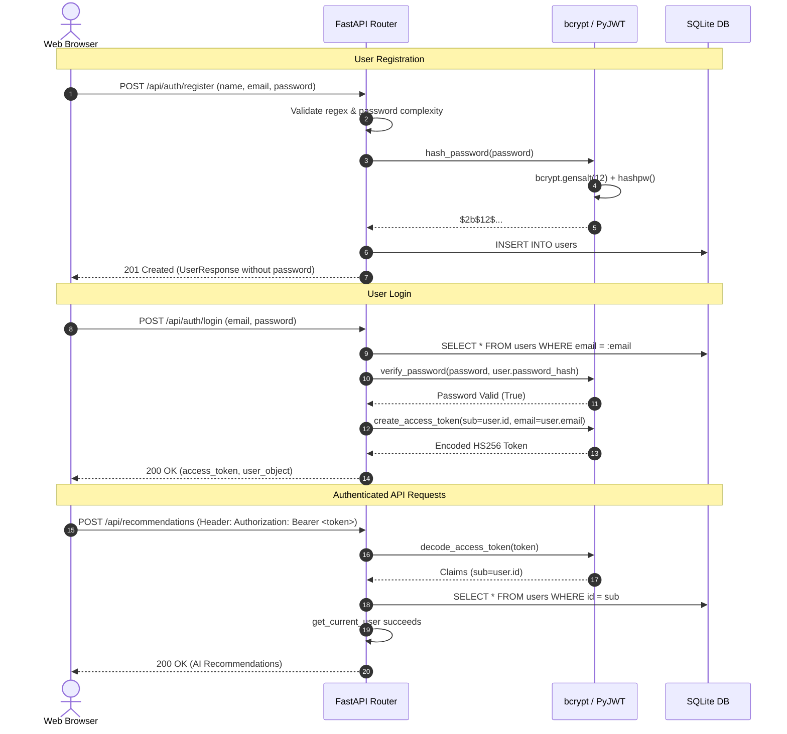

# Authentication and Security Architecture

## Overview
The application implements an industry-standard, stateless **JSON Web Token (JWT)** authentication framework that strictly adheres to RFC 7519 and cryptographic best practices.



## Security Features

### 1. Password Hashing with Salt Rounds
- **Algorithm**: `bcrypt` (Blowfish-based cipher).
- **Cost Factor**: 12 salt rounds (`gensalt(rounds=12)`).
- **Security Properties**:
  - Automatically incorporates a cryptographically random per-user salt.
  - Mitigates precomputed rainbow table attacks.
  - Computationally intensive to resist high-speed GPU/ASIC brute-force cracking.

### 2. Cryptographic JWT Signing
- **Algorithm**: `HS256` (HMAC with SHA-256).
- **Secret Key**: Loaded from `JWT_SECRET_KEY` in environment.
- **Key Generation Recommendation**:
  ```bash
  python -c "import secrets; print(secrets.token_hex(32))"
  ```
- **Claim Integrity**:
  - `sub`: User ID (`int`)
  - `email`: User email (`str`)
  - `iat`: Timestamp of token issuance
  - `exp`: Timestamp of token expiration (24-hour default)

### 3. Timing-Attack Safe Verification
- During login, verification evaluates credentials in constant time to prevent user enumeration via timing differentials.

### 4. Client-Side Route Guards & Token Hygiene
- Tokens are stored in `localStorage` under `concierge_jwt_token`.
- The hash router blocks navigation to protected views if no token exists.
- The HTTP client traps any `401 Unauthorized` response, immediately purges stored credentials, dispatches an auth change event, and redirects to `#login`.
