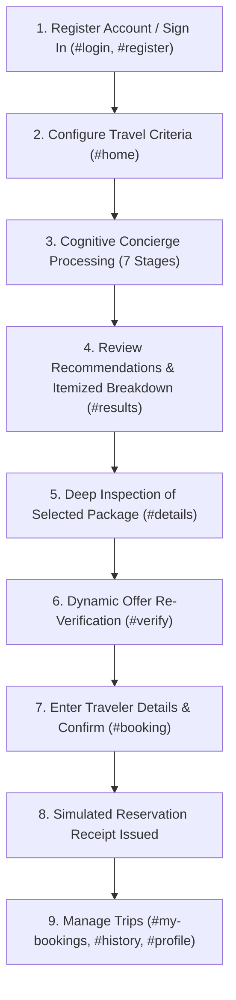

# Complete Application Workflow: User Journey & Lifecycle

## End-to-End Traveler Lifecycle

## Detailed Stage Walkthrough

### 1. Account Creation and Authentication
- A new traveler visits `http://127.0.0.1:5500/#login`.
- If unauthenticated, attempts to access `#home` are intercepted by the router and redirected to `#login`.
- Traveler switches to `#register`, enters name, email, and password.
- Upon successful registration, the client automatically signs in, stores the JWT token in `localStorage`, updates the navbar with their name and a *"Sign Out"* button, and routes to `#home`.

### 2. Specifying Travel Parameters
- On `#home`, the traveler inputs:
  - Origin City (e.g., Delhi) and Destination City (e.g., Mumbai)
  - Travel Dates (Departure and Return)
  - Number of Adult Passengers (e.g., 2)
  - Financial Budget Ceiling (e.g., ₹60,000)
  - Preferences: Hotel star rating (3, 4, 5-star, Hard/Soft), preferred airline, flight stops (Non-stop, Hard/Soft), and amenities.
- Client validation checks for proper city differentiation and logical calendar sequencing.

### 3. Agent Execution & Results Presentation
- The form dispatches `POST /api/recommendations` with the Bearer JWT token.
- The 7-stage cognitive concierge processes candidate flights and hotels, filters infeasible packages, and ranks feasible packages.
- The view transitions to `#results`, rendering:
  - **Best Recommended Package**: Highlight card showcasing outbound flight, return flight, hotel, and total price.
  - **Itemized Breakdown**: Mathematical breakdown detailing flight fares per adult and hotel nightly rates.
  - **Natural Language Explanation**: Clear reasoning for the recommendation and budget surplus.
  - **Alternative Packages**: Diverse options for traveler comparison.

### 4. Package Inspection & Pre-Booking Verification
- Traveler clicks *"View Details"* on an itinerary, navigating to `#details` to inspect layover times, flight durations, and hotel amenities.
- Traveler clicks *"Proceed to Offer Verification"*, navigating to `#verify`.
- The system calls `POST /api/verify-offer` to check live provider inventory:
  - `VERIFIED`: Price and inventory confirmed.
  - `OFFER_REPRICED`: Fares adjusted; difference clearly displayed.
  - `OFFER_EXPIRED`: Inventory exhausted; blocks checkout to protect traveler.

### 5. Reservation Confirmation & History Management
- Traveler proceeds to `#booking`.
- Traveler information is automatically pre-filled from the user profile.
- Traveler must check the explicit confirmation toggle: *"I confirm this simulated travel booking"*.
- The reservation is confirmed via `POST /api/booking/confirm`.
- A formal booking receipt appears containing:
  - Booking Reference code (`SIM-RES-XXXXXXXX`)
  - Status (`CONFIRMED_SIMULATED`)
  - Total charged in INR
  - Clear academic simulation disclaimer
- The traveler can view all confirmed trips in `#my-bookings` and review aggregate statistics in `#profile`.
