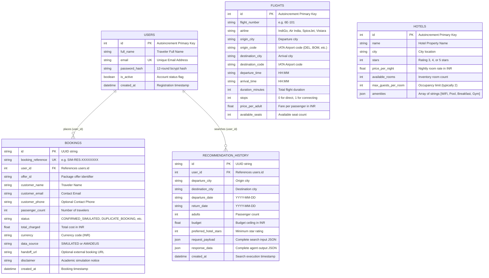

# Database Design: Schema & Relationships

## Database Architecture
The application uses SQLAlchemy 2.0 ORM with SQLite for local execution and PostgreSQL support for production deployments.



## Migration & Schema Synchronization
In `backend/app/database.py`, the `init_db()` function includes automated schema inspection via SQLAlchemy's `inspect(engine)`. If existing database files lack the `user_id` foreign key columns on `bookings` or `recommendation_history`, it automatically runs:
```sql
ALTER TABLE bookings ADD COLUMN user_id INTEGER REFERENCES users(id);
ALTER TABLE recommendation_history ADD COLUMN user_id INTEGER REFERENCES users(id);
```
This guarantees seamless backward compatibility without requiring manual migration scripts.
