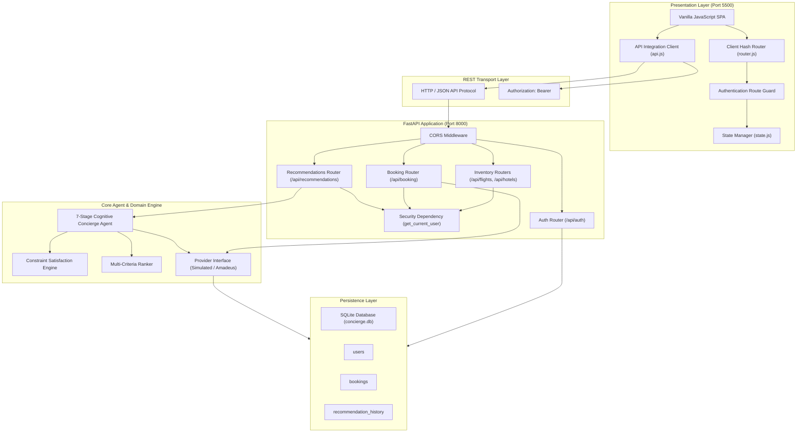

# System Architecture: Automated E-Commerce Concierge Agent

## Architectural Philosophy
The system follows a decoupled, multi-tier client-server architecture designed for high availability, deterministic execution, and clear separation of concerns.

## Architectural Tiers

### 1. Presentation Tier (Vanilla Frontend)
- **Host**: Python `http.server` running on `http://127.0.0.1:5500`.
- **Implementation**: Pure HTML5, CSS3 with modern CSS custom properties, and modular ES6 JavaScript.
- **Routing**: Client-side hash routing (`window.location.hash`) intercepting `#login`, `#register`, `#home`, `#results`, `#details`, `#verify`, `#booking`, `#my-bookings`, `#history`, and `#profile`.
- **Client State**: Centralized `AppStateManager` persisting JWT access tokens and session data in browser `localStorage`.
- **Network Interceptor**: `api.js` automatically attaches `Authorization: Bearer <token>` to requests and traps `401 Unauthorized` responses to safely force user re-authentication.

### 2. Application & API Tier (FastAPI Backend)
- **Host**: Uvicorn ASGI server running on `http://127.0.0.1:8000`.
- **Validation**: Strict payload validation using Pydantic schemas.
- **Dependency Injection**: Reusable dependencies (`get_db`, `get_current_user`) for connection lifecycle management and route security.
- **Error Handling**: Centralized exception handler ensuring all API errors return standardized JSON envelopes (`{"status": "ERROR", "message": "...", "path": "..."}`).

### 3. Intelligence & Optimization Tier (Agent Core)
- **ConciergeAgent**: Encapsulates the 7-stage sense–plan–act cycle.
- **Decoupled Providers**: Abstract `TravelProviderInterface` allowing transparent swapping between offline `SimulatedTravelProvider` and live GDS adapters (`AmadeusProviderAdapter`).

### 4. Data & Persistence Tier (SQLAlchemy & SQLite)
- **Engine**: SQLAlchemy 2.0 with connection pooling.
- **Tables**: `users`, `bookings`, `recommendation_history`, `flights`, and `hotels`.
- **Migration**: Automatic schema inspection on startup ensuring backward-compatible addition of columns and foreign keys.
